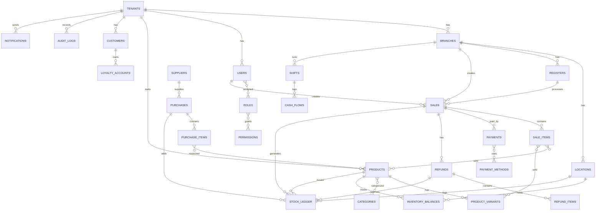

# Backend POS - ERD and Data Dictionary

Tanggal: 2026-03-09

## ERD Ringkas

## Data Dictionary (Ringkas)

### tenants
- id (uuid, pk)
- name, timezone, domain, subdomain, logo_url
- created_at

### branches (outlet)
- id (uuid, pk)
- tenant_id (fk)
- name

### locations (stock location)
- id (uuid, pk)
- tenant_id (fk)
- branch_id (fk)
- name, is_default

### registers
- id (uuid, pk)
- tenant_id (fk)
- branch_id (fk)
- location_id (fk, nullable)
- name, device_uid, status
- created_at, updated_at

### users
- id (uuid, pk)
- tenant_id (fk)
- name, email, password, status
- created_at, updated_at, deleted_at

### roles / permissions
- roles: id, tenant_id, name
- permissions: id, perm_key, description
- user_roles: user_id, role_id
- role_permissions: role_id, permission_id

### categories
- id, tenant_id, name, slug

### products
- id, tenant_id
- sku, name, price, hpp_average
- category_id, is_active

### product_variants
- id, tenant_id, product_id
- sku, barcode, name, attributes, price_override, is_active

### price_lists
- id, tenant_id, branch_id
- name, is_active, starts_at, ends_at

### pricing_rules
- id, tenant_id, price_list_id
- product_id, product_variant_id
- price, min_qty, starts_at, ends_at

### customers
- id, tenant_id, name, phone, email, address

### loyalty_accounts
- id, tenant_id, customer_id, loyalty_tier_id
- points, created_at

### suppliers
- id, tenant_id, name, balance, created_at

### purchases
- id, tenant_id, supplier_id
- total, status, created_at

### purchase_items
- id, tenant_id, purchase_id
- product_id, product_variant_id
- qty, price, received_qty

### inventory_balances
- tenant_id, location_id, product_id, product_variant_id
- qty_on_hand

### stock_ledger
- id, tenant_id, location_id
- product_id, product_variant_id
- reference_type, reference_id
- qty_in, qty_out, balance_after
- created_at, created_by

### sales
- id, tenant_id, branch_id, register_id
- shift_id, customer_id
- subtotal, discount, tax, total
- status, idempotency_key
- created_by, voided_by, created_at

### sale_items
- id, tenant_id, sale_id
- product_id, product_variant_id
- qty, price, discount, hpp_snapshot

### payments
- id, tenant_id, sale_id
- payment_method_id, method
- account_id, amount

### payment_methods
- id, tenant_id, name, method_type, is_active

### discounts
- id, tenant_id, sale_id
- type, value, notes, created_at

### taxes
- id, tenant_id, name, description, rate, is_active, created_at

### tax_lines
- id, tenant_id, sale_id, tax_id
- rate, amount, created_at

### refunds
- id, tenant_id, sale_id, branch_id
- created_by, total, status, reason, created_at

### refund_items
- id, tenant_id, refund_id
- product_id, qty, amount

### shifts
- id, tenant_id, branch_id, user_id
- opened_at, closed_at, opening_cash, closing_cash
- system_cash_total, difference, status

### cash_flows
- id, tenant_id, shift_id, branch_id
- type, amount, note, created_at

### audit_logs
- id, tenant_id, user_id
- action, entity_type, entity_id
- payload_json, created_at

### notifications
- id, tenant_id, channel, target, payload_json
- status, created_at

### daily_sales_summaries
- id, tenant_id, date
- total_sales, total_tax, total_discount, total_cost
- transaction_count, updated_at

### inventory_summaries
- id, tenant_id, location_id, product_id
- current_qty, current_value, updated_at
