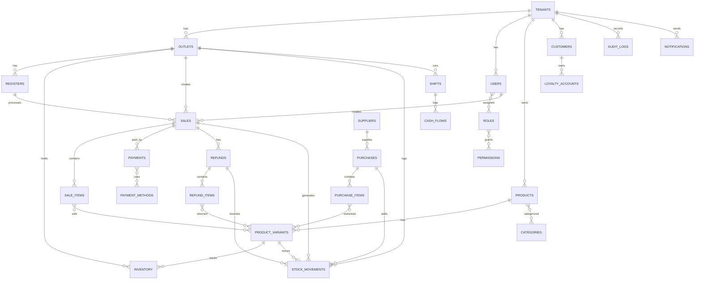

# Backend POS - ERD Detail (Ringkas)

ERD detail berikut menjabarkan relasi utama agar siap diterjemahkan ke schema.

Catatan:
- Semua tabel transaksi memiliki tenant_id dan outlet_id.
- Semua aksi penting memiliki created_by untuk audit.
- stock_movements menjadi ledger utama untuk stok.

## Lampiran Audit Index/FK
Lihat ringkasan audit index dan foreign key di [docs/backend-pos/backend-pos-index-fk-audit.md](backend-pos-index-fk-audit.md).
