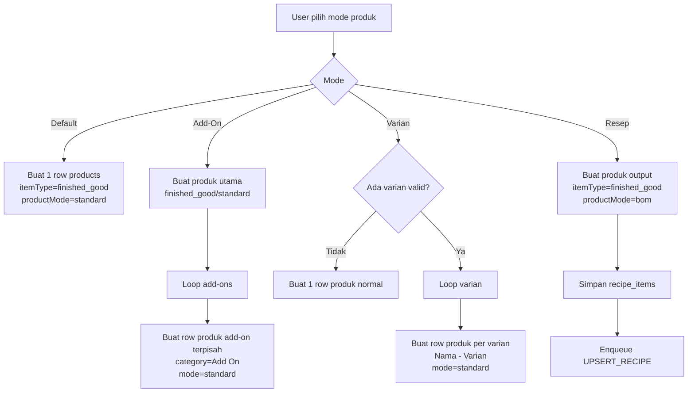
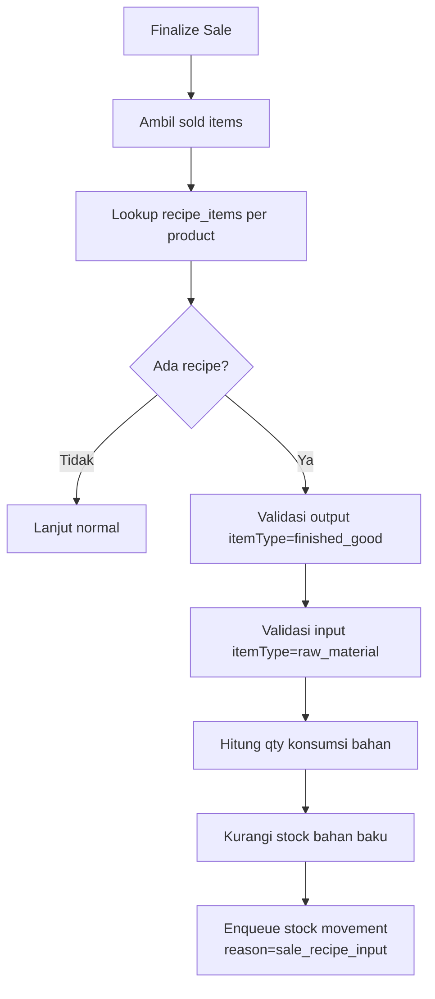

# Product Mode Flow di APK Android

Dokumen ini menjelaskan mode produk di APK saat ini: Default, Add-On, Varian, dan Resep.
Fokus dokumen ini adalah perilaku aktual di source code, bukan desain ideal masa depan.

## Ringkasan

- Default: membuat 1 produk normal.
- Add-On: membuat produk utama + beberapa produk add-on terpisah.
- Varian: membuat beberapa produk terpisah per varian.
- Resep: membuat produk output + menyimpan komponen resep (BOM) di recipe_items.

Catatan penting:
- Relasi formal antar tabel hanya jelas pada mode Resep (melalui recipe_items.productLocalId -> products.localId).
- Add-On dan Varian saat ini masih pola "generate banyak produk", belum memakai parent-child relation khusus.

## Data Model yang Dipakai

### products
Kolom penting:
- localId
- name
- categoryName
- itemType
- productMode
- price
- stockOnHand

Interpretasi umum:
- itemType: peran stok produk (contoh: finished_good atau raw_material)
- productMode: metadata mode (contoh: standard atau bom)

### recipe_items
Kolom penting:
- productLocalId (produk output)
- materialProductLocalId (produk bahan baku)
- materialName
- qty
- unit

Fungsi:
- Menjadi source of truth komposisi resep/BOM per produk output.

## Alur Simpan Produk per Mode

### 1. Default
- User isi form produk standar.
- APK membuat 1 row di products.
- itemType diisi finished_good.
- productMode diisi standard.

### 2. Add-On
- APK membuat 1 produk utama (finished_good, standard).
- Untuk setiap add-on name, APK membuat produk tambahan terpisah:
  - nama: "NamaProduk - NamaAddOn"
  - categoryName: Add On
  - itemType: finished_good
  - productMode: standard
- Tidak ada relasi parent-child eksplisit di database saat ini.

### 3. Varian
- Jika varian valid tersedia, APK membuat beberapa row produk:
  - nama: "NamaProduk - NamaVarian"
  - harga sesuai varian
  - stok awal dibagi rata antar varian
  - itemType: finished_good
  - productMode: standard
- Jika varian kosong, fallback ke 1 produk normal.
- Tidak ada relasi parent-child eksplisit di database saat ini.

### 4. Resep
- APK membuat 1 produk output dengan:
  - itemType: finished_good
  - productMode: bom
- APK menyimpan daftar komponen ke recipe_items.
- APK enqueue outbox UPSERT_RECIPE dengan payload bom_items/recipe_items.

## Dampak ke Transaksi POS

Pada finalize sale:
- Sistem mencari recipe_items berdasarkan sold product id.
- Jika ada recipe_items, sistem melakukan auto-consume bahan baku.
- Validasi penting:
  - produk output harus finished_good
  - produk bahan harus raw_material
- Jika valid, stock bahan baku berkurang dan outbox stock movement dibuat dengan reason sale_recipe_input.

Implikasi:
- Penentu auto-consume utama adalah recipe_items + itemType.
- productMode bersifat metadata/hint, bukan satu-satunya rule eksekusi.

## Diagram Alur

## Diagram Konsumsi Resep saat Penjualan

## Batasan Saat Ini

- Add-On belum punya relasi struktural ke produk utama.
- Varian belum punya relasi parent/option model khusus.
- UI resep di APK sudah ada untuk kasus dasar, tetapi setup lanjutan tetap lebih aman via web backoffice.

## Saran Teknis Bertahap (tanpa refactor besar)

1. Tambah kolom referensi opsional untuk produk turunan (mis. parentProductLocalId).
2. Tambah productRole sederhana (main, add_on, variant) untuk filtering yang lebih jelas.
3. Pertahankan recipe_items sebagai source of truth BOM karena sudah terpakai di transaksi.
